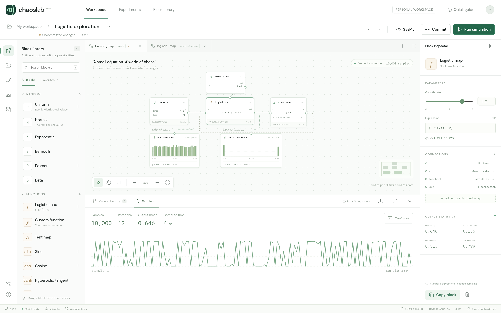

# Chaos Lab

A local-first visual exploration environment for chaotic systems. The static site bundles all runtime libraries and stores each visitor's Git repository in IndexedDB. Working tabs and recoverable closed drafts are stored in localStorage.

## See a system in action

The screenshots below show the running dashboard with **10,000 samples**, **seed 42**, and **12 feedback iterations**. The model applies the logistic rule `x[n+1] = r * x[n] * (1 - x[n])` to uniformly distributed initial conditions.

### Build a feedback system and watch its distributions

A uniform random source feeds a logistic function, a growth-rate block controls `r`, and a unit delay closes the feedback loop. Taps display the input and output distributions beside the model. The inspector shows the symbolic derivative and output statistics; the Git panel keeps the exploration history in view.


### Inspect a chaotic run

At **r = 3.9**, the output spreads across a broad, uneven distribution. The expanded Simulation panel shows the run settings, mean, compute time, and a trace of the first 150 output samples. This trace compares ensemble samples, rather than following a single trajectory through time.


### Change one parameter and see a two-cycle emerge

Changing the growth rate to **r = 3.2**, with the same seed and initial input distribution, concentrates the output around two values. The output histogram and statistics update directly from the model.



To reproduce these views, open the Logistic exploration model, select the Logistic map block, change **Growth rate**, and click **Run simulation**. Open **Simulation** and expand the bottom panel to inspect the complete sample trace.

[Open the deployed dashboard](https://chaos-lab-studio.sunsetsaffron1.chatgpt.site) · Private deployment; access is required. You can also run the bundled app locally using the instructions below.

## Develop and verify

```sh
npm install
npm run build
npm run check
```

Serve `dist/` with a static HTTP server. No application server or environment secrets are required. Deploy identity is in `.openai/hosting.json`.

## Implemented

- 41 blocks across random sources, custom functions, standard math, symbolic calculus, combinatorics, logic, dynamics, and distribution taps.
- Drag-and-drop nodes, click-to-connect ports, editable parameters and expressions, pan/zoom, multi-selection, copy/paste, and per-tab undo/redo.
- Reproducible ensemble sampling with a seed and explicit iteration count. Feedback goes through a Unit delay block.
- Nerdamer symbolic expression compilation, derivatives, antiderivatives, and custom functions.
- Git blobs, trees, commits, and branch refs written by isomorphic-git to LightningFS/IndexedDB. Each commit records `model.json` and `model.sysml` and includes the model name, seed, block count, and sample count in its message.
- An ancestry-based Git graph, branch creation, historical commit tabs, side-by-side comparison, and cross-tab block copy/paste. Saving a historical revision automatically creates a new branch to preserve existing branch heads.
- A portable tar export including `.git`; verified with native `git fsck --full`.
- JSON and SysML draft export. Example history is initialized on first visit.

## Current boundaries

This is a functional prototype. SysML is a generated textual representation, not a validated or executable SysML 2.0 implementation. The executable graph remains in JSON. Full SysML interchange/import, symbolic probability-density propagation, advanced solvers, and remote Git authentication/sync are not implemented. Beta sampling currently accepts positive integer shape parameters. A visitor's model repository is device-local; export it before clearing browser data. Remote Git can be used with the downloaded repository through standard Git tooling.

Unit tests cover the simulation, symbolic transformations, error handling, Git object storage, branches, and export. A DOM interaction smoke test covers the primary editing and versioning flows. The deployed app was also verified in Chromium for startup, simulation, parameter changes, live distribution plots, and the expanded results panel. The screenshots above were captured at a 1600 × 1000 viewport with 2× pixel density.
