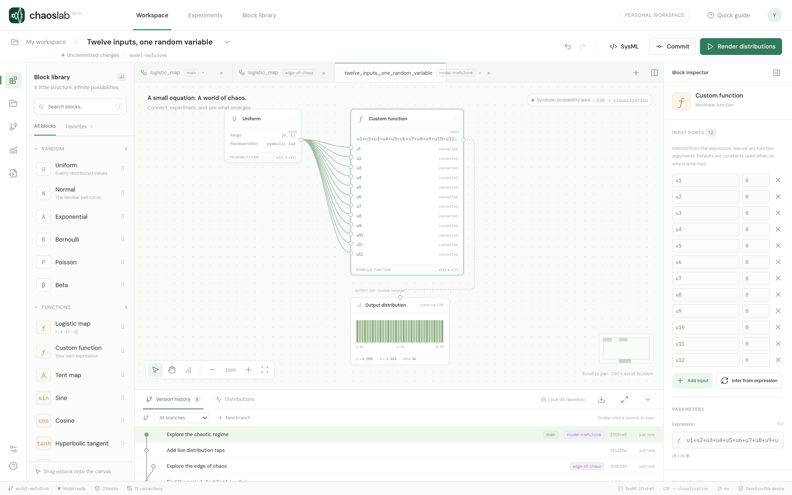
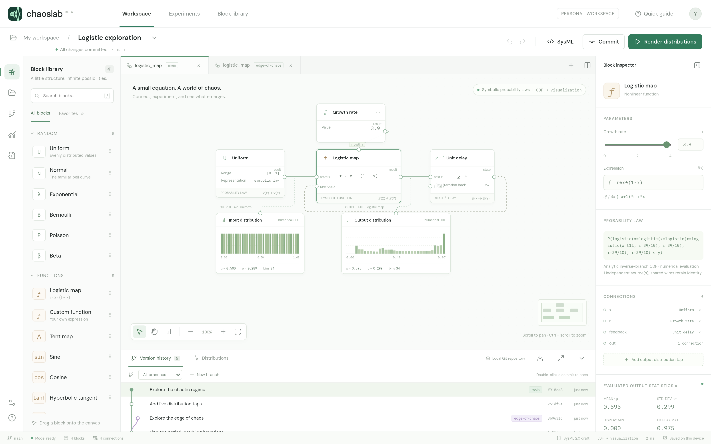
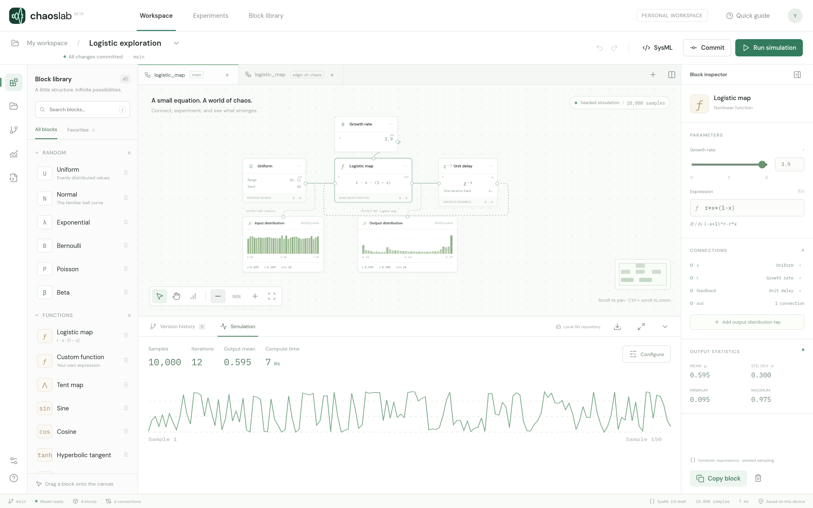

# Chaos Lab

A visual studio for symbolic probability systems. Source blocks define probability laws; function blocks transform symbolic random variables. The engine derives the final law before any visualization evaluates it. Shared wires retain identity, so `X - X` is exactly zero. There is no source sampling or Monte Carlo graph execution.

[Download releases](https://github.com/wa200508/chaos_lab/releases) · [Private hosted dashboard](https://chaos-lab-studio.sunsetsaffron1.chatgpt.site) · [Mathematical contract](docs/symbolic-engine.md)

[Explore the hydrogen 1s ground-state example](docs/examples/hydrogen-1s.md)

## Run locally

Native preview releases bundle the web app and its local server. **No Node, Python, or Julia installation is needed to run the dashboard.** A current browser is required. The server opens **http://127.0.0.1:4173** and serves only the bundled app; keep its process running while you work.

| Platform | Release asset | Start |
| --- | --- | --- |
| Windows 10/11 x64 | `chaos-lab-2.0.0-beta.1-windows-x64.zip` | Extract, then run `chaos-lab.exe`. |
| Ubuntu 22.04/24.04 x64 | `chaos-lab-2.0.0-beta.1-ubuntu-x64.deb` | `sudo apt install ./chaos-lab-2.0.0-beta.1-ubuntu-x64.deb`, then `chaos-lab`. |
| EL9 x64, including Rocky/Alma/RHEL 9 | `chaos-lab-2.0.0-beta.1-el9-x64.rpm` | `sudo dnf install ./chaos-lab-2.0.0-beta.1-el9-x64.rpm`, then `chaos-lab`. |
| Linux x64 portable | `chaos-lab-2.0.0-beta.1-linux-x64.tar.gz` | Extract, then run `./chaos-lab`. |
| Docker on Linux or Docker Desktop | `chaos-lab-2.0.0-beta.1-docker-amd64.tar.gz` | Load and run the image as shown below. |

These are unsigned preview builds. Releases include SHA-256 checksums. See [release and build instructions](docs/releases.md) for verification, architecture support, and the native test matrix.

```sh
# Use the Docker image from a release; no registry sign-in is required.
docker load -i chaos-lab-2.0.0-beta.1-docker-amd64.tar.gz
docker run --rm -p 127.0.0.1:4173:4173 chaos-lab:2.0.0-beta.1

# Or build from a checkout:
docker compose up --build
```

### Run from source

Install Node.js 24, then:

```sh
git clone https://github.com/wa200508/chaos_lab.git
cd chaos_lab
npm ci
npm run build
npm start -- --open
```

The same commands work on Windows and Linux; use `npm.cmd` if PowerShell's script policy blocks `npm.ps1`. `--port 5000` changes the local port; `--no-open` suppresses browser launch. All runtime JavaScript, fonts, and assets are bundled, so the dashboard works offline after installation.

**Your models and Git history live in your browser profile, scoped to the host and port.** They survive server/container restarts. Changing browsers, ports, or clearing browser storage creates a different workspace. Export your model repository before moving between machines. A Docker volume is not the model store.

## Build, connect, and inspect

- Drag a block from the library. Every port has a visible name, a purpose tooltip, and an accessible label.
- Drag an output to an input, or click an output and then an input. Drag a connected input or a selected wire's endpoint handle to reconnect it. Dropping on empty space cancels the change.
- Drag a connection line to change its route. Select it and choose **Reset route** to restore the default curve. Routing is saved in the model and participates in undo/redo.
- Custom functions infer their inputs from the expression. `u1 + u2 + ... + u12` produces twelve ports. The inspector also provides **Add input**, editable names/default constants, removal, and **Infer from expression**. Manual lists stay under your control; undeclared expression variables produce a model error. Renaming a port updates its expression references and connections.
- Select **Add distribution tap**, then click any named input or output. Taps plot bin probabilities evaluated from that port's final CDF.
- Built-in logistic/tent blocks label the initial state `x`, growth parameter `r`, and previous state `feedback`. Custom feedback loops can use a Unit delay's **initial x** and **next x** ports, with any custom argument name on the function.
- Commit creates real Git objects containing the graph, SysML draft, and exact symbolic DAG. Open historical commits in separate tabs, split the canvas, and copy blocks between designs.

### Twelve named inputs

One uniform source is connected to all twelve arguments below. Because those wires share the same random variable, summing them gives `12X`, a uniform law on `[0,12]`, rather than the convolution of twelve independent uniforms.



## Symbolic engine and visualization

The compiler in `src/engine.js` and `src/laws.js` constructs a shared expression DAG and its joint pushforward probability measures. It does not create sample arrays or call a probability RNG. Parameters are represented as symbolic scalars, including exact rational forms of decimal inputs.

`src/visualization.js` is a separate numerical layer. Supported CDFs use analytic transformations, every inverse branch of non-monotone maps, exact finite PMFs, Gaussian affine laws, and uniform convolutions. General laws remain explicit symbolic joint integrals. Where supported, a tap evaluates those integrals with deterministic quadrature; it never switches to Monte Carlo. Rendering limits and approximations are identified in the UI, and an unsupported visualization retains its symbolic law.

Density bars use CDF differences directly. The optional lower-panel trace draws from the completed **final render CDF**, using a labeled interpolation table. Seed and draw count affect that trace only; they do not change the graph's law or histogram. Approximate moments, finite plotting windows, and numerical quadrature are labeled. See [the full mathematical contract and limits](docs/symbolic-engine.md).

## Export Python or Julia

Open **Export** in the bottom panel and choose **Python symbolic system** or **Julia symbolic system**. Both files include the complete equation DAG, source identities, custom inputs, finite feedback expansion, and **every visualization tap**, including taps on named custom input ports.

The Python export constructs SymPy equations and exact symbolic CDF integrals/sums. The Julia export constructs Symbolics equations and a structured joint pushforward CDF. Both keep numerical CDF evaluation in their plotting functions and never draw upstream source samples.

Python 3.10+:

```sh
python -m venv .venv
# Activate .venv (Windows: .venv\Scripts\activate; Linux: source .venv/bin/activate).
python -m pip install -r export-environments/python/requirements.txt
python model.py --show-symbolic --no-plot
python model.py --output distributions.png
```

Julia 1.11:

```sh
julia --project=export-environments/julia -e 'using Pkg; Pkg.instantiate()'
julia --project=export-environments/julia model.jl --show-symbolic --no-plot
julia --project=export-environments/julia model.jl --output distributions.png
```

A portable release includes the `export-environments` directory. A downloaded script also includes standalone dependency-installation instructions in its header. Exports plot each attached tap's probability-per-bin view and CDF. `--no-plot` lets you inspect or import the symbolic system without opening a figure.

## Screenshots

The examples use a uniform initial law and 12 symbolic logistic-map iterations. The histograms display final-law bin probabilities. The lower trace consists of independent display draws from the final CDF, not a propagated ensemble or a single trajectory.



At `r = 3.9`, inspect the derived distribution and its numerical visualization:



At `r = 3.2`, the finite-iteration distribution concentrates near a two-cycle:


## Development and verification

```sh
npm run build
npm run check
npx playwright-core install chromium
npm run test:browser
python -m pip install -r export-environments/python/requirements.txt
npm run test:exports
julia --project=export-environments/julia tests/export-julia.jl .export-test
```

The tests cover symbolic/no-RNG compilation, analytic CDF identities, shared-source correlations, mixed point masses, custom input signatures, feedback initialization, Git storage, launchers, Python/Julia semantics and plots, offline browser use, and actual drag/rewire/reroute gestures. CI verifies Windows and Ubuntu, builds the native release assets, installs the RPM inside EL9, and tests the Docker image before publishing a version tag.

## Current boundaries

This remains a preview. SysML 2.0 output is a textual representation, not a validated/executable SysML implementation. General multivariate laws are represented symbolically even when the renderer cannot evaluate them. There is no automatic remote Git authentication/sync, indefinite stationary-distribution solver, stochastic-process innovation block, or universal closed-form solver. Different source blocks are independent; one source is reused through feedback as the same initial random variable. The render seed never changes that assumption.
