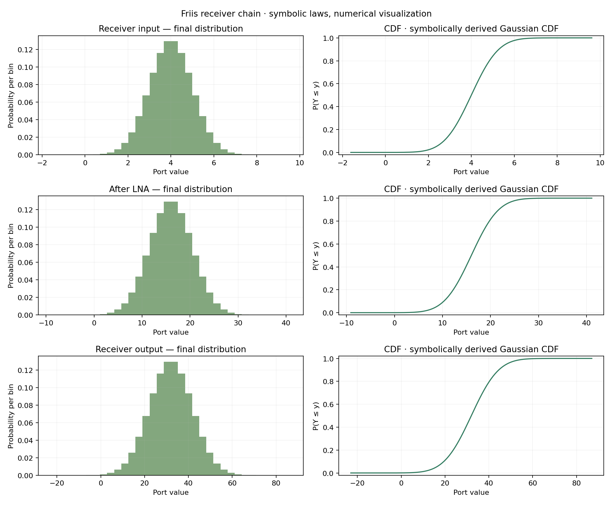

# Noise through an RF receiver

Open **New model → RF · Friis receiver chain**. Follow **Receiver input**, **After LNA**, and **Receiver output** from top to bottom. Select a tap to see its exact Gaussian law and the names of the noise sources that reach it.


To launch this example from Git on Windows or Linux, use Node.js 24 and the bundled dashboard on the example branch.

```sh
git clone --branch example/rf-receiver https://github.com/wa200508/chaos_lab.git chaos-lab-rf
cd chaos-lab-rf
node scripts/server.cjs --open
```

## The paper and the model

Harald T. Friis derived how the noise factors of individual receiver stages determine the noise factor of a cascade in “Noise Figures of Radio Receivers,” *Proceedings of the IRE*, 32(7), 419–422 (1944). OpenAlex listed 1,168 citing works on November 26, 2026. [Original paper](https://doi.org/10.1109/JRPROC.1944.232049) · [Citation record](https://openalex.org/W2071786386)

The example uses two matched, linear stages over one fixed noise bandwidth. We follow the in-phase amplitude of a steady carrier, normalized so the reference source noise has variance 1. The low-noise amplifier (LNA) feeds an equivalent intermediate-frequency (IF) amplifier. Frequency conversion is ideal with unity gain. The gains and noise levels below are illustrative choices. Friis supplies the independent prediction for the cascade.

Each purple block introduces one independent, zero-mean Gaussian noise amplitude. Each amplifier adds its own equivalent **input-referred** noise, then multiplies the sum by its **amplitude** gain. With equal reference impedances, power gain is the square of amplitude gain. These ordinary blocks produce all three tap laws before the plots render.

| Tap | Connected operations | Mean | Noise variance | Signal-to-noise ratio, μ²/variance |
| --- | --- | ---: | ---: | ---: |
| Receiver input | Add source noise (σ = 1) to carrier amplitude 4 | 4 | 1 | 16 |
| After LNA | Add LNA noise (σ = 0.5), multiply by 4 | 16 | 20 | 12.8 |
| Receiver output | Add IF noise (σ = 2), multiply by 2 | 32 | 96 | 10⅔ |

At the output, source noise contributes 64 units of variance, the LNA contributes 16, and the IF amplifier contributes 16. The source and LNA noise pass through both gains. The IF amplifier's noise passes through the last gain only.

## Check the cascade against Friis

The two individual noise factors, each referred to the reference input variance of 1, are **F₁ = 1 + 0.5² = 1.25** and **F₂ = 1 + 2² = 5**. The LNA has power gain **G₁ = 4² = 16**. Friis predicts **F = F₁ + (F₂ − 1)/G₁ = 1.50**. Independently, the input and output taps give **F = SNRᵢₙ/SNRₒᵤₜ = 16/(32²/96) = 1.50**, or **1.76 dB**.

1. Commit the default model. Select **LNA gain** and change **Second operand** from **4** to **2**.
2. Select **Receiver output**. Its mean falls to **16** and its variance falls to **36**. The carrier power has fallen faster than the noise power, so the receiver's noise figure rises to **3.52 dB**.
3. Restore the LNA gain to **4** and change **IF gain** from **2** to **1**. The output mean becomes **16** and its variance **24**. The final gain scales the signal and all accumulated noise together, so the noise figure stays at **1.76 dB**.

The Python and Julia exports include all three visualizations. Each plot uses its own amplitude axis. Compare the axis values or the tap variances to see the changing width.


