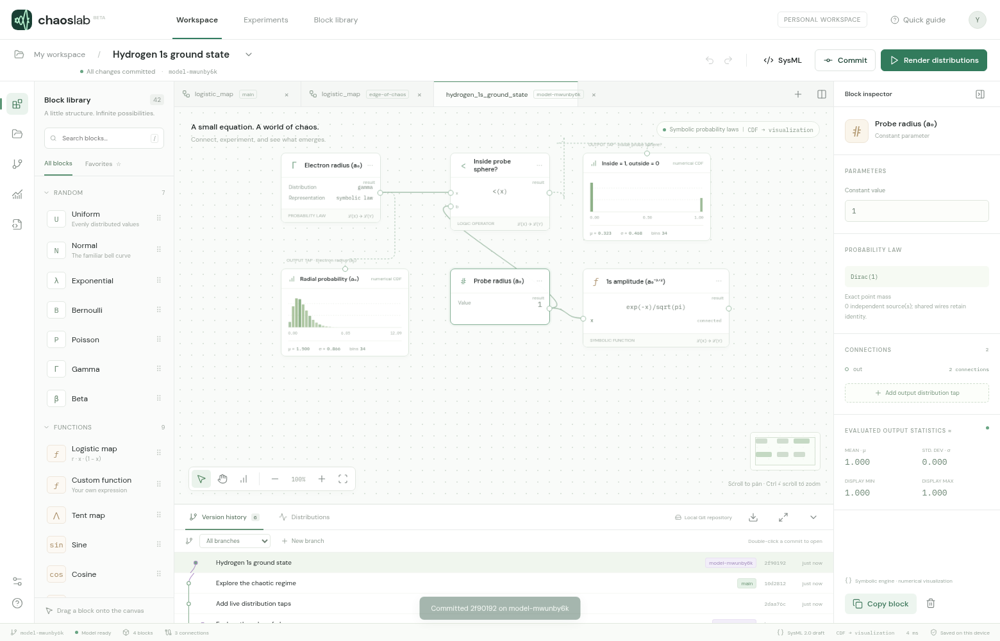

# Hydrogen 1s

## Dashboard changes needed

The spatial ground state of isolated, nonrelativistic hydrogen has a real, spherically symmetric stationary wavefunction. Existing custom functions and constants can evaluate its amplitude at a chosen radius. Existing taps can show scalar measurement probabilities. The block library lacks the Gamma law for the Born radial distribution. The source schema, inspector, CDF renderer, and both script exporters need the same shape/rate convention. The template picker needs an entry that assembles these pieces as an editable graph.

This first example assumes a fixed point proton, atomic units, and the pure spatial eigenstate with n = 1, ℓ = 0, m = 0. Spin, external fields, and superpositions are outside this example. Time evolution contributes only a global phase to this eigenstate.

## Open and explore

Choose **New model → Starting point → Hydrogen atom · 1s ground state**, then **Create model**. The template opens as an editable model in its own tab. Use **Commit** to save your design to the dashboard’s local Git history.

Let `s = r/a₀`, with Bohr radius `a₀ ≈ 52.92 pm`. The ground-state energy is −1/2 hartree (about −13.6 eV). The spatial amplitude in units of `a₀⁻³ᐟ²` is `exp(−s)/√π`. Squaring this gives probability per unit volume. Multiplying by the spherical shell factor gives radial density `4s² exp(−2s)` for `s ≥ 0`, normalized to one. This matches Gamma with shape 3 and rate 2. The angular distribution is uniform over solid angle.

1. Inspect **Electron radius**. Its radial tap shows probability per bin. The most probable radius is one Bohr radius and the mean is 1.5 Bohr radii.
2. Select **Probe radius** and enter a nonnegative radius in Bohr units. Select **1s amplitude** to inspect the wavefunction evaluated at that point.
3. The **Inside = 1, outside = 0** tap measures a binary observable. Its mean equals the probability inside the sphere, `1 − exp(−2s)(1 + 2s + 2s²)`. Changing the probe radius from 1 to 2 changes the enclosed probability from 32.33% to 76.19%.
4. Use **Export** to generate a Python or Julia script with both measurement taps. The Gamma source encodes the analytic Born law for this specific wavefunction. Editing the amplitude formula or Gamma parameters independently creates a different graph and requires rederiving their relationship.

