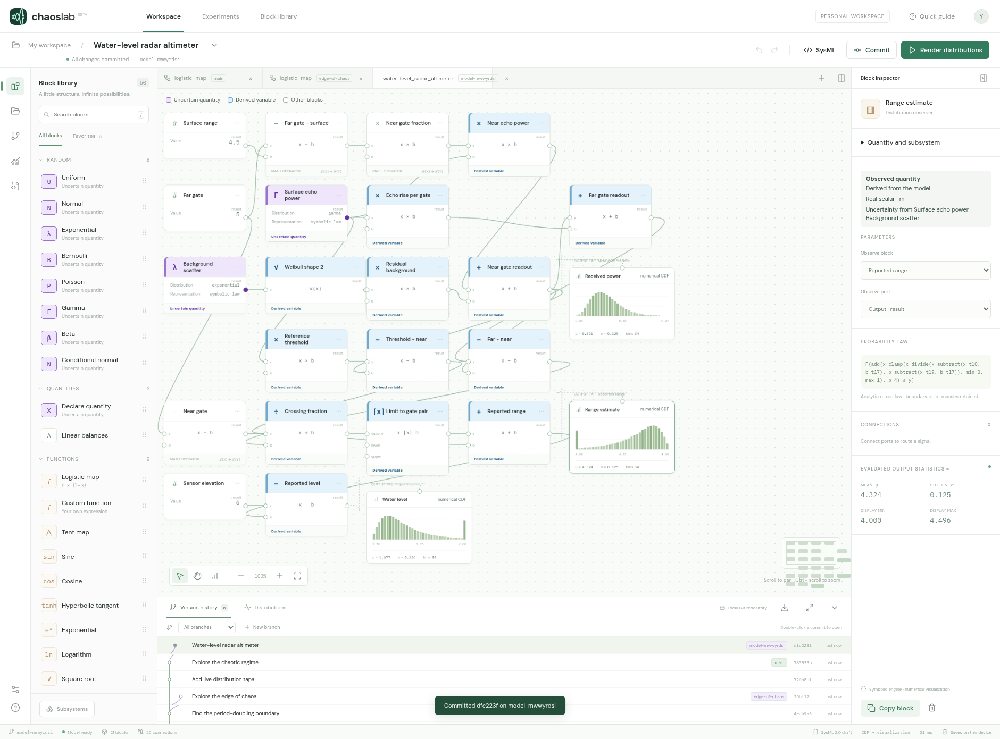
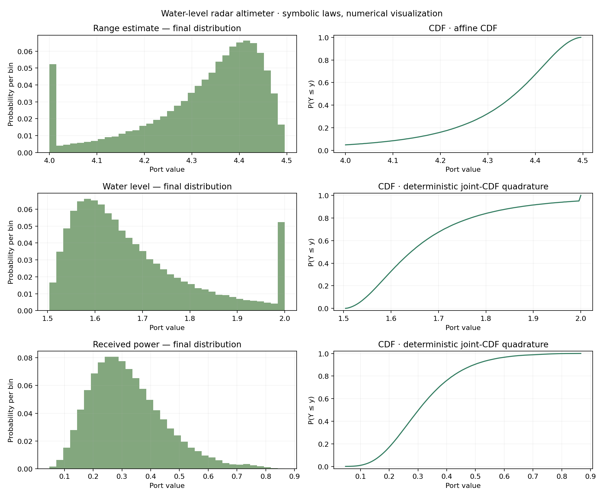

# What range does the water-level radar report?

Choose **New model → Radar · Water-level estimator**. The sensor is 6 m above the datum. The stationary water surface is 4.50 m from the sensor, so its true level is 1.50 m. The **Range estimate** tap shows the distribution of readings the instrument reports with that geometry held fixed. **Water level** converts the same reading to elevation. Click **Received power** to inspect the measurement before the estimator.



## Trace one measurement through the blocks

1. **Surface and echo.** Two adjacent receive gates correspond to 4 m and 5 m of round-trip-delay-derived range. Within this window the leading edge is a straight ramp that rises by half the peak power per metre. At the true range, the clean power is half its peak. The peak power varies between acquisitions and is shared across the waveform. Its default gamma law (shape 4, rate 4) models the average of four independent unit-mean exponential power looks. The true range and gate calibration are constants.
2. **Power readout.** Both gates see the same fluctuating residual background power. A square root of a unit-rate exponential followed by a scale of 0.08 produces a Weibull law with shape 2. This is a model of correlated background in detected power. The example assumes a separate background-corrected peak reference and ideal readout electronics.
3. **Threshold retracker.** The receiver subtracts the measured near-gate power from half the reference peak and divides by the measured far-minus-near power. That fraction locates the crossing between the gates. The receiver clips it to the available pair, converts it to range, and subtracts range from the mounting elevation to estimate water level. The estimator has no direct wire from the true range.

The method is inspired by Curt H. Davis's 1997 paper *A robust threshold retracking algorithm for measuring ice-sheet surface elevation change from satellite radar altimeters*. Davis estimates a surface elevation from the leading edge of a measured echo. This teaching model uses a stationary water surface, a prescribed two-gate window and a calibrated peak reference. The waveform, power laws and numerical results here belong to the example. [Original paper](https://doi.org/10.1109/36.602540)

## Change the receiver's background

Select **Residual background → Second operand**. Compare the default 0.08 with 0.04. Commit each setting to compare the two designs side by side. The table gives independent numerical integrals of the symbolic model. The displayed histogram uses deterministic quadrature and its moments can differ slightly.

| Background scale | Mean reported range | Median reported range | Probability of reporting exactly 4 m |
| ---: | ---: | ---: | ---: |
| 0.08 | 4.323 m | 4.358 m | 4.86% |
| 0.04 | 4.407 m | 4.429 m | 0.63% |

Stronger background makes the echo cross the threshold earlier. A weak surface echo magnifies the shift. The near gate collects all crossings that fall before the window, leaving a point mass at exactly 4 m. At the default settings the range variance is **0.01594 m²**, the standard deviation is **0.1263 m**, and the bias is **−0.1770 m**. Setting the background scale to zero recovers 4.50 m for every positive echo power. Keep the true range within the modelled one-metre gate pair when exploring.



## From a sampling distribution to a confidence interval

Let (A) be the echo peak and (B) the residual background, in normalized power units. In this one-metre gate pair, the power slope is (A/2) per metre, so a background offset shifts the inferred range towards the sensor by (D=2B/A) metres. For a true range (r) the receiver reports `clip(r − D, 4, 5)`. The block graph derives this result from the two powers.

For background scale (s), conditional on (A=a), the probability that the shift exceeds (d) metres is `exp(−(ad/(2s))²)` for (d≥0). Integrating this quantity over the gamma peak law gives the independent benchmarks above. The default shift's 2.5% and 97.5% quantiles are **0.02293 m** and **0.63637 m**. Inverting the central 95% of the measurement law, an interior reading of **4.25 m** gives a model-based confidence interval of **[4.273, 4.886] m** for the true range. For a reading clipped to **4.00 m**, inversion gives **[4.000, 4.636] m**. The clipping can make coverage conservative. These intervals assume the specified power laws and known gate geometry.

## Run locally

With Node.js 24 installed, start the bundled dashboard from this example branch.

```sh
git clone --branch example/water-level-altimeter https://github.com/wa200508/chaos_lab.git chaos-lab-altimeter
cd chaos-lab-altimeter
node scripts/server.cjs --open
```

Open the model from **New model**. **Export** generates a standalone Python or Julia version containing the connected system and all three plots.
